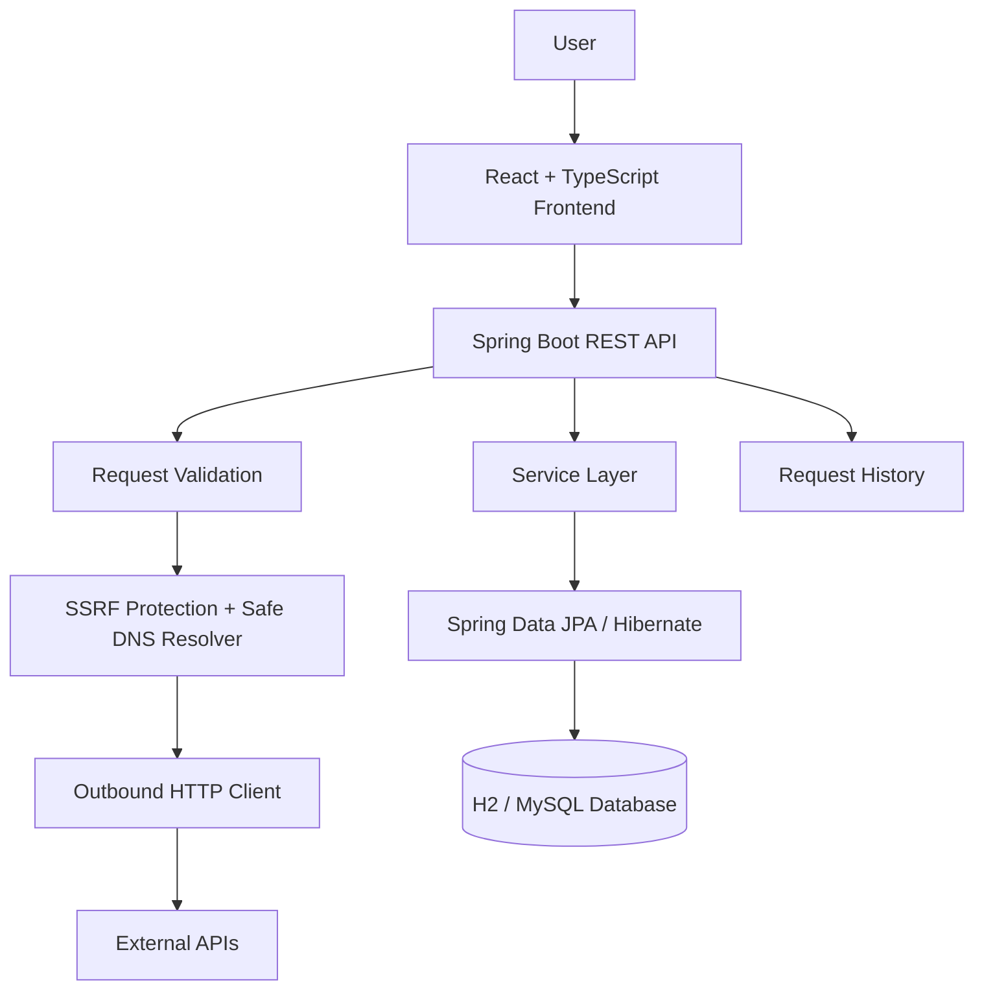

# API Testing Playground

A full-stack API testing platform built with React, TypeScript, Java, Spring Boot, and MySQL/H2. It allows users to create, configure, send, and inspect HTTP requests through a browser-based interface.

The project demonstrates full-stack development, REST API integration, backend engineering, database persistence, automated testing, and security-focused request execution.

---

## Features

### API Request Builder
- Support for `GET`, `POST`, `PUT`, `PATCH`, and `DELETE`.
- Configure request URLs, query parameters, headers, and request bodies.
- Support API key and authorization headers.
- Execute requests through the Spring Boot backend.
- Inspect response status, headers, body, and execution time.
- Handle network errors and request timeouts.
- Cancel requests from the frontend.

### Request Management
- Save and organize request collections.
- Manage environments and variables.
- Reuse saved requests.
- View request execution history.
- Persist collections, environments, and history using the backend database.

---

## Security

Security was an important part of the backend implementation:
- **Server-Side Request Validation:** Outbound target URLs are strictly validated before execution.
- **SSRF Protection:** Defense against private networks (RFC 1918), loopback (`127.0.0.0/8`, `::1`), link-local (`169.254.0.0/16`, `fe80::/10`), and cloud metadata destinations (`169.254.169.254`, `metadata.google.internal`).
- **DNS Resolution Validation:** Custom `SafeDnsResolver` wired into Apache HttpClient 5 connection manager to defend against DNS rebinding (TOCTOU) attacks at socket connection time.
- **Manual Redirect Handling:** Automatic client redirects are disabled; redirects are validated hop-by-hop up to a maximum limit with loop detection and protocol downgrade prevention.
- **Cross-Origin Credential Stripping:** In accordance with RFC 7235 and Fetch standards, sensitive headers (`Authorization`, `Cookie`, `X-API-Key`, etc.) and credentials are automatically stripped when a redirect targets a different origin (scheme, host, or port).
- **IPv6 Protection:** Byte-level validation against RFC 4193 IPv6 Unique Local Address range (`fc00::/7` covering `fc00::/8` and `fd00::/8`) and unwrapping of IPv4-mapped IPv6 addresses (`::ffff:x.x.x.x`).
- **Query Parameter & Header Redaction:** Sensitive query parameter keys (`apiKey`, `token`, `password`, `secret`, etc.) and headers (`Authorization`, `Cookie`, `X-API-Key`) are masked with `[REDACTED]` prior to history persistence.
- **Recursive JSON Body Secret Redaction:** Recursively redacts sensitive JSON keys in nested objects and arrays within persisted request history.
- **Resource Limits:** Connection timeout (10s), configurable response timeout, and maximum response payload bounds (5MB) prevent denial-of-service exhaustion.

### Documented Security Limitations
These limitations are documented rather than presented as solved security features:
- **Environment Secrets:** Environment variables marked as secret are still returned by the environment API (`GET /api/v1/environments`). UI masking in the frontend does not protect these values from users with direct API access.
- **Backend Request Cancellation:** Frontend cancellation via `AbortController` terminates the client-to-backend connection, but does not currently guarantee cancellation of the backend's synchronous outbound request executing on the servlet worker thread.
- **Non-JSON Payloads:** Malformed or non-JSON request bodies (e.g., plain text or custom encodings) may not receive the same recursive secret redaction as valid JSON payloads.

---

## Technology Stack

| Layer | Technologies |
|---|---|
| **Frontend** | React 18, TypeScript, Vite |
| **Styling** | Tailwind CSS |
| **HTTP Client** | Axios |
| **Backend** | Java 17, Spring Boot 3 |
| **Persistence** | Spring Data JPA, Hibernate |
| **Database** | H2 (embedded file mode), MySQL 8 |
| **Database Migrations** | Flyway |
| **Testing** | JUnit 5, Mockito, Vitest, React Testing Library |
| **API Documentation** | Springdoc OpenAPI (Swagger UI) |
| **Containerization** | Docker, Docker Compose |
| **CI** | GitHub Actions |

---

## Architecture

The frontend communicates with the Spring Boot backend. The backend manages application data and executes outbound HTTP requests on behalf of the user.



---

## Getting Started

### Prerequisites
Install the following tools:
- **Java 17** (JDK 17)
- **Maven** (3.8+)
- **Node.js** (18+) and **npm** (9+)
- **Git**

Optional:
- **Docker Desktop**
- **MySQL 8**

---

### 1. Clone the Repository
```bash
git clone https://github.com/mdsaifswe/api-testing-playground.git
cd api-testing-playground
```

---

### 2. Start the Backend
Open a terminal:
```bash
cd backend
mvn spring-boot:run
```

The backend should be available at:
- **Application URL:** `http://localhost:8080`
- **Health Check:** `http://localhost:8080/api/v1/health`
- **API Documentation (Swagger UI):** `http://localhost:8080/swagger-ui.html`

*The default local configuration uses H2, so a separate MySQL installation is not required for the basic local setup.*

---

### 3. Start the Frontend
Open a second terminal from the project root:
```bash
cd frontend
npm install
npm run dev
```

Open your browser at:
`http://localhost:5173`

---

### 4. Run with Docker
If Docker Desktop is installed and running:
```bash
docker-compose up --build -d
```

The Docker Compose configuration provides a containerized multi-service environment:
- **Frontend:** `http://localhost:3000` (Nginx serving production bundle)
- **Backend API:** `http://localhost:8080`
- **MySQL 8:** Port `3306` (`api_testing_playground` database)

To stop the containers:
```bash
docker-compose down
```

---

## Running Tests

### Backend Tests
From the `backend` directory:
```bash
mvn test
```

### Frontend Tests
From the `frontend` directory:
```bash
npm test
```

### Frontend Production Build
```bash
npm run build
```

### Reported Test Results
The latest project verification report recorded:

| Test Suite | Passed | Failed | Skipped |
|---|---|---|---|
| **Backend (JUnit 5 + MockMvc)** | 45 | 0 | 0 |
| **Frontend (Vitest + React Testing Library)** | 13 | 0 | 0 |
| **Total** | **58** | **0** | **0** |

The reported backend package (`mvn package -DskipTests`) and frontend production build (`npm run build`) also completed successfully.

> [!NOTE]
> **Verification scope:** These are results from the latest local verification report. A live MySQL 8 runtime and a successful GitHub Actions execution have not yet been independently confirmed.

---

## Project Structure

```text
api-testing-playground/
├── backend/
│   ├── src/
│   │   ├── main/
│   │   │   ├── java/
│   │   │   └── resources/
│   │   └── test/
│   └── pom.xml
├── frontend/
│   ├── src/
│   ├── public/
│   └── package.json
├── docker-compose.yml
├── README.md
└── .github/
    └── workflows/
        └── ci.yml
```

---

## Engineering Highlights

This project goes beyond basic CRUD operations:
- Designed a full-stack application with a React frontend and Spring Boot backend.
- Implemented outbound HTTP request execution for multiple HTTP methods (`GET`, `POST`, `PUT`, `PATCH`, `DELETE`, `HEAD`, `OPTIONS`).
- Built persistent request collections, environments, and execution history.
- Implemented SSRF defenses using DNS validation, socket connection checking, and redirect destination checks.
- Added sensitive-data redaction for query parameters, headers, and JSON request bodies before request history persistence.
- Developed automated backend and frontend tests.
- Configured Docker-based development and CI workflow infrastructure.

---

## Known Limitations and Future Improvements

The project is a portfolio and learning application, not a claim of enterprise production readiness.

Potential improvements include:
- Protect environment secrets from being exposed through API responses (e.g. server-side vault integration or write-merge masking).
- Implement backend-aware request cancellation (e.g. reactive Spring WebFlux pipelines or servlet async cancellation hooks).
- Expand secret redaction to additional body formats (e.g. XML, GraphQL, multipart form-data).
- Verify the complete application against a live MySQL 8 instance.
- Validate the GitHub Actions workflow through a successful hosted run.
- Add more integration and end-to-end tests.
- Add screenshots and a short application demo video.

---

## Resume Highlights

**API Testing Playground | Full-Stack Development Project**
- Built a full-stack API testing platform using React, TypeScript, Java 17, and Spring Boot 3, supporting `GET`, `POST`, `PUT`, `PATCH`, and `DELETE` requests.
- Implemented request collections, environment variables, execution history, and response inspection with persistent database storage.
- Developed backend SSRF protections, DNS validation, secure redirect handling, and sensitive-data redaction.
- Added automated backend and frontend tests using JUnit 5, Mockito, Vitest, and React Testing Library.
- Configured Docker-based deployment infrastructure and GitHub Actions CI workflow.

---

## Author

**Md. Saif**
- GitHub: [@mdsaifswe](https://github.com/mdsaifswe)
- Project Repository: [api-testing-playground](https://github.com/mdsaifswe/api-testing-playground)

*Built to demonstrate practical full-stack development, API engineering, automated testing, and security-conscious backend design.*
