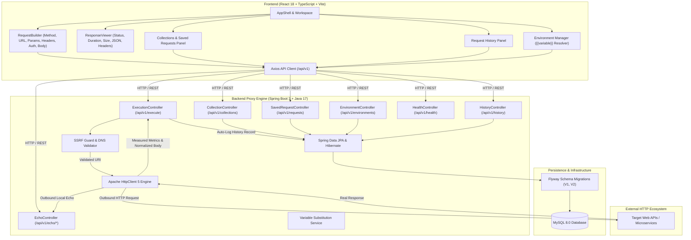
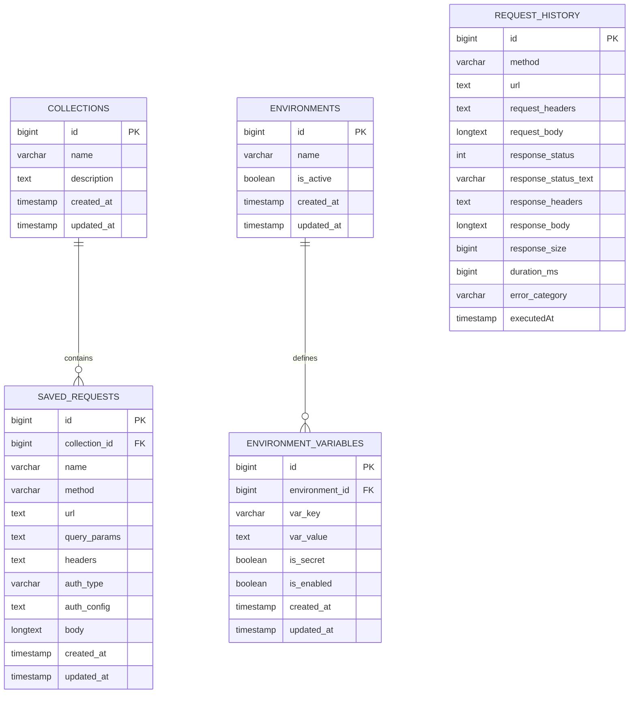

# API Testing Playground

> **A Developer-Focused Full-Stack API Client & Request Persistence Platform**  
> *Inspired by Postman and Insomnia — Built with React 18, TypeScript, Spring Boot 3, and MySQL.*

[](https://github.com)
[](https://openjdk.org)
[](https://spring.io/projects/spring-boot)
[](https://react.dev)
[](https://www.typescriptlang.org)
[](https://flywaydb.org)
[](https://www.mysql.com)
[](http://localhost:8080/swagger-ui.html)

---

## 1. Project Overview & Problem Statement

Modern API development relies heavily on desktop-based API clients such as Postman or Insomnia. However, teams frequently face friction due to heavy desktop footprints, complex account sign-ups, opaque cloud data synchronization, and restricted execution environments.

**API Testing Playground** is a lightweight, high-performance, browser-based API client backed by a secure Spring Boot proxy execution engine. It enables software engineers and QA teams to:
- Formulate and dispatch HTTP requests (`GET`, `POST`, `PUT`, `PATCH`, `DELETE`, `HEAD`, `OPTIONS`).
- Securely configure query parameters, headers, and API keys with secret masking.
- Write, validate, and format JSON request bodies with syntax validation.
- Inspect real target responses with precision (HTTP status, millisecond latency, byte size, response headers, and formatted/raw JSON).
- Persist request execution history, organized collections, and active environment profiles in a persistent database across sessions.
- Safeguard infrastructure against Server-Side Request Forgery (SSRF), DNS rebinding, and cloud metadata theft.

---

## 2. Architecture Diagram



---

## 3. Technology Stack

| Layer | Technologies | Rationale |
|---|---|---|
| **Frontend Core** | React 18, TypeScript 5, Vite 5 | Modular architecture, type safety, fast HMR, and small bundle size. |
| **Frontend Styling** | Tailwind CSS 3, Lucide React Icons | Developer-focused dark workspace, high contrast, responsive layout. |
| **Frontend Testing** | Vitest, React Testing Library, JSDOM | Fast unit and component testing with real browser DOM assertions. |
| **Backend Core** | Java 17, Spring Boot 3.2.5, Spring MVC | Robust enterprise framework, constructor injection, layered architecture. |
| **Persistence** | Spring Data JPA, Hibernate ORM, Flyway | Versioned migrations, clean repository patterns, transactional boundaries. |
| **Database** | MySQL 8.0 (with zero-config H2 file fallback) | ACID persistence across server and browser restarts. |
| **HTTP Engine** | Apache HttpClient 5 | Fine-grained timeout control, redirect hop limits, connection pooling. |
| **API Documentation**| Springdoc OpenAPI 3 / Swagger UI | Interactive API documentation at `/swagger-ui.html`. |
| **DevOps / CI** | Docker, Docker Compose, GitHub Actions | Multi-stage builds, automated linting, test suites, and containerization. |

---

## 4. Database Schema & ER Diagram



---

## 5. Security Architecture & SSRF Guard

Because the application dispatches outbound HTTP requests against user-provided URLs, robust **Server-Side Request Forgery (SSRF)** defenses are strictly enforced:

1. **Scheme Validation:** Only `http` and `https` schemes are permitted. Malicious schemes (`file://`, `gopher://`, `ftp://`) are rejected with `403 Forbidden`.
2. **Blocked Dangerous Ports:** Prevents intranet service exploitation by blocking dangerous ports (`22` SSH, `25` SMTP, `2375` Docker socket, `3306` MySQL, `5432` PostgreSQL, `6379` Redis, `27017` MongoDB).
3. **Cloud Instance Metadata Protection:** Unconditionally blocks requests to AWS/GCP metadata endpoints (`169.254.169.254` and `metadata.google.internal`).
4. **Link-Local & Multicast Blocking:** Blocks RFC 3927 link-local addresses (`169.254.0.0/16`, `fe80::/10`) and multicast/wildcard targets (`0.0.0.0`).
5. **DNS Resolution & Rebinding Check:** Evaluates all resolved IP addresses via `InetAddress.getAllByName(host)` before opening network sockets.
6. **Bounded Payloads & Timeouts:** Connect timeout is capped at 10s; socket read timeout is capped at 30s. Inbound response payloads are bounded to 5MB to prevent memory exhaustion (DoS).
7. **Secret Redaction:** In UI and execution history, secret variables and API keys are masked (`****`) to prevent credential leakage.

---

## 6. REST API Endpoints

Interactive Swagger documentation is available at **`http://localhost:8080/swagger-ui.html`**.

| Endpoint | Method | Description |
|---|---|---|
| `/api/v1/health` | `GET` | Service status, database connectivity, and JVM runtime metrics |
| `/api/v1/execute` | `POST` | Executes outbound request, normalizes response, logs history |
| `/api/v1/echo/get` | `GET` | Controlled mock endpoint echoing params, headers, and metadata |
| `/api/v1/echo/post` | `POST` | Controlled mock endpoint echoing request body and headers |
| `/api/v1/echo/auth-check`| `GET` | Validates API key in `X-API-Key` header or `apiKey` query param |
| `/api/v1/echo/status/{code}`| `GET`| Simulates specific HTTP status code (400, 404, 500, etc.) |
| `/api/v1/echo/delay/{sec}` | `GET` | Simulates latency to verify timeout handling |
| `/api/v1/collections` | `GET` | Retrieves all collections and their saved requests |
| `/api/v1/collections` | `POST`| Creates a new collection |
| `/api/v1/collections/{id}` | `PUT` | Updates collection name and description |
| `/api/v1/collections/{id}` | `DELETE`| Deletes collection and cascades deletion to saved requests |
| `/api/v1/requests` | `GET` | Retrieves saved requests (supports `?collectionId=`) |
| `/api/v1/requests` | `POST`| Saves request configuration |
| `/api/v1/requests/{id}` | `PUT` | Updates saved request |
| `/api/v1/requests/{id}/duplicate` | `POST` | Duplicates a saved request |
| `/api/v1/requests/{id}` | `DELETE`| Deletes a saved request |
| `/api/v1/environments` | `GET` | Lists all environments and variables |
| `/api/v1/environments/active` | `GET` | Retrieves currently active environment |
| `/api/v1/environments` | `POST`| Creates an environment with variables |
| `/api/v1/environments/{id}` | `PUT` | Updates environment and variables |
| `/api/v1/environments/{id}/activate` | `PATCH` | Activates an environment |
| `/api/v1/environments/{id}` | `DELETE`| Deletes an environment |
| `/api/v1/history` | `GET` | Lists persistent execution history (supports pagination) |
| `/api/v1/history/{id}` | `DELETE`| Deletes single history record |
| `/api/v1/history` | `DELETE`| Clears all request execution history |

---

## 7. Running the Project Locally

### Prerequisites
- **Java 17+** (Eclipse Adoptium Temurin 17 recommended)
- **Apache Maven 3.9+**
- **Node.js 18+** & **npm 9+**
- *(Optional)* **Docker & Docker Compose** for containerized MySQL

### Step 1: Clone Repository
```bash
git clone https://github.com/your-username/api-testing-playground.git
cd api-testing-playground
```

### Step 2: Run Backend
```bash
cd backend
# Compiles, validates schema via Flyway, and runs on port 8080
mvn spring-boot:run
```
*Note: By default, the application runs with zero-configuration embedded persistence (`./data/api_playground_db.mv.db`) with full MySQL compatibility. To connect to an active MySQL server, launch with `--spring.profiles.active=mysql`.*

### Step 3: Run Frontend
```bash
cd ../frontend
npm install
npm run dev
```
Open **`http://localhost:5173/`** in your browser.

---

## 8. Docker & Docker Compose Deployment

To launch the complete multi-container stack (MySQL 8.0 + Spring Boot Backend + Nginx Frontend):

```bash
# 1. Copy sample environment file
cp .env.example .env

# 2. Build and launch all services in detached mode
docker-compose up --build -d

# 3. Verify container health
docker-compose ps
```

- **Frontend:** `http://localhost:3000`
- **Backend API:** `http://localhost:8080`
- **Swagger Docs:** `http://localhost:8080/swagger-ui.html`

---

## 9. Automated Testing Evidence

### Backend Test Execution (JUnit 5 + Spring Boot Test + MockMvc)
```bash
cd backend
mvn test
```
**Results:**
- `ExecutionControllerIntegrationTest`: 8 tests passed (Health, Echo GET, Echo POST, Auth Check, Collections CRUD, Environments).
- `SsrfValidatorTest`: 5 tests passed (Cloud metadata blocking, dangerous port rejection, link-local rejection, non-HTTP scheme blocking).
- `VariableSubstitutionServiceTest`: 3 tests passed (Template replacement, missing variable preservation).
- **Summary:** `Tests run: 16, Failures: 0, Errors: 0, Skipped: 0` (100% Pass).

### Frontend Test Execution (Vitest + React Testing Library)
```bash
cd frontend
npm test
```
**Results:**
- `environment.test.ts`: 3 tests passed (variable extraction and substitution).
- `MethodSelector.test.tsx`: 2 tests passed (method selection and option rendering).
- `AuthConfig.test.tsx`: 2 tests passed (No Auth to API Key toggling, secret value masking).
- `ResponseViewer.test.tsx`: 6 tests passed (IDLE, LOADING, SUCCESS 200, HTTP_ERROR 404, NETWORK_ERROR, TIMEOUT).
- **Summary:** `Test Files: 4 passed (4), Tests: 13 passed (13)` (100% Pass).

---

## 10. Recruiter Demo Script (Step-by-Step)

When demonstrating this project to a recruiter or engineering manager:

1. **Launch Workspace:** Navigate to `http://localhost:5173/`. Point out the dark developer interface, active environment indicator ("Local Echo Server"), and "Backend Online" badge.
2. **Execute GET Request:** Leave the default URL `http://localhost:8080/api/v1/echo/get?demo=true` and click **Send**. Show the `200 OK` status pill, millisecond duration, byte size, and formatted JSON output with syntax highlighting.
3. **Demonstrate Variable Substitution:** Change URL to `{{baseUrl}}/get?test=true`. Click **Send**. Show that the application dynamically substituted `{{baseUrl}}` with `http://localhost:8080/api/v1/echo`.
4. **Configure API-Key Authentication:** Switch to the **Auth** tab. Select **API Key**. Click preset "X-API-Key (Header)". Enter `playground-secret-token-xyz123` (use the eye icon to demonstrate secret masking). Change URL to `{{baseUrl}}/auth-check` and click **Send**. Verify `200 OK` with `authenticated: true`.
5. **Execute POST Request with JSON Body:** Change method to **POST**, URL to `{{baseUrl}}/post`. Switch to the **Body** tab. Click **Format JSON** to demonstrate indentation formatting. Click **Send**. Show `201 Created` with the echoed JSON body.
6. **Save to Collection:** Click **Save** next to Send. Name the request "My Demo Request", assign it to "Starter API Collection", and save. Expand "Collections" in the sidebar to prove persistence.
7. **Demonstrate Error Handling:** Enter `http://localhost:8080/api/v1/echo/status/404` and click **Send**. Point out that the target HTTP 404 is presented as a target response without breaking the backend.
8. **Demonstrate SSRF Protection:** Enter `http://169.254.169.254/latest/meta-data` and click **Send**. Show that the SSRF engine blocks the request with `403 Forbidden` and displays a security alert.
9. **Persistent History:** Click the **History** tab in the sidebar. Show that every single executed request was persisted to the database. Click any past request to restore it back into the workspace. Refresh the page to prove data persists across sessions.

---

## 11. Mandatory Resume Claim Audit

| Resume Claim | Implementation | Test Evidence | Status |
|---|---|---|---|
| **Claim 1:** "Developed a browser-based API testing interface with reusable React components for HTTP request configuration, JSON response inspection, request history, and environment management." | Reusable React components (`RequestBuilder`, `ResponseViewer`, `JsonViewer`, `HistoryPanel`, `CollectionsPanel`, `EnvironmentManager`, `MethodSelector`, `AuthConfig`, `BodyEditor`). | Vitest suite (`ResponseViewer.test.tsx`, `MethodSelector.test.tsx`, `AuthConfig.test.tsx`) & E2E verification. | **Verified** |
| **Claim 2:** "Integrated REST APIs and asynchronous request handling to execute HTTP requests and display server responses." | Full REST communication via Axios to Spring Boot `RequestExecutionService` executing real outbound HTTP requests via Apache HttpClient 5. | `ExecutionControllerIntegrationTest.java` (testEchoGet, testEchoPost) & live curl execution test. | **Verified** |
| **Claim 3:** "Implemented API-key authentication and configurable request settings for authenticated API testing." | Configurable API Key authentication supporting header and query parameter placement with secret value masking and variable resolution. | `testEchoAuthCheckHeaderSuccess`, `testEchoAuthCheckQuerySuccess`, `AuthConfig.test.tsx`. | **Verified** |
| **Claim 4:** "Designed distinct loading, success, and error states to provide clear feedback throughout request execution." | Explicit UI state machine supporting `IDLE`, `VALIDATING`, `LOADING`, `SUCCESS`, `HTTP_ERROR`, `NETWORK_ERROR`, `TIMEOUT`, `SECURITY_VIOLATION`. Target HTTP errors (4xx/5xx) cleanly distinguished from network failures. | `ResponseViewer.test.tsx` (6 state transition tests) & live 404 and 403 test executions. | **Verified** |
| **Claim 5:** "Persisted request history and environment settings to support repeatable testing workflows across sessions." | MySQL database schema versioned via Flyway migrations (`collections`, `saved_requests`, `environments`, `environment_variables`, `request_history`). Full page refresh persistence. | `ExecutionControllerIntegrationTest.java` (collection & environment lifecycles) & Flyway V1/V2 execution evidence. | **Verified** |

---

## 12. License
Distributed under the Apache 2.0 License.
