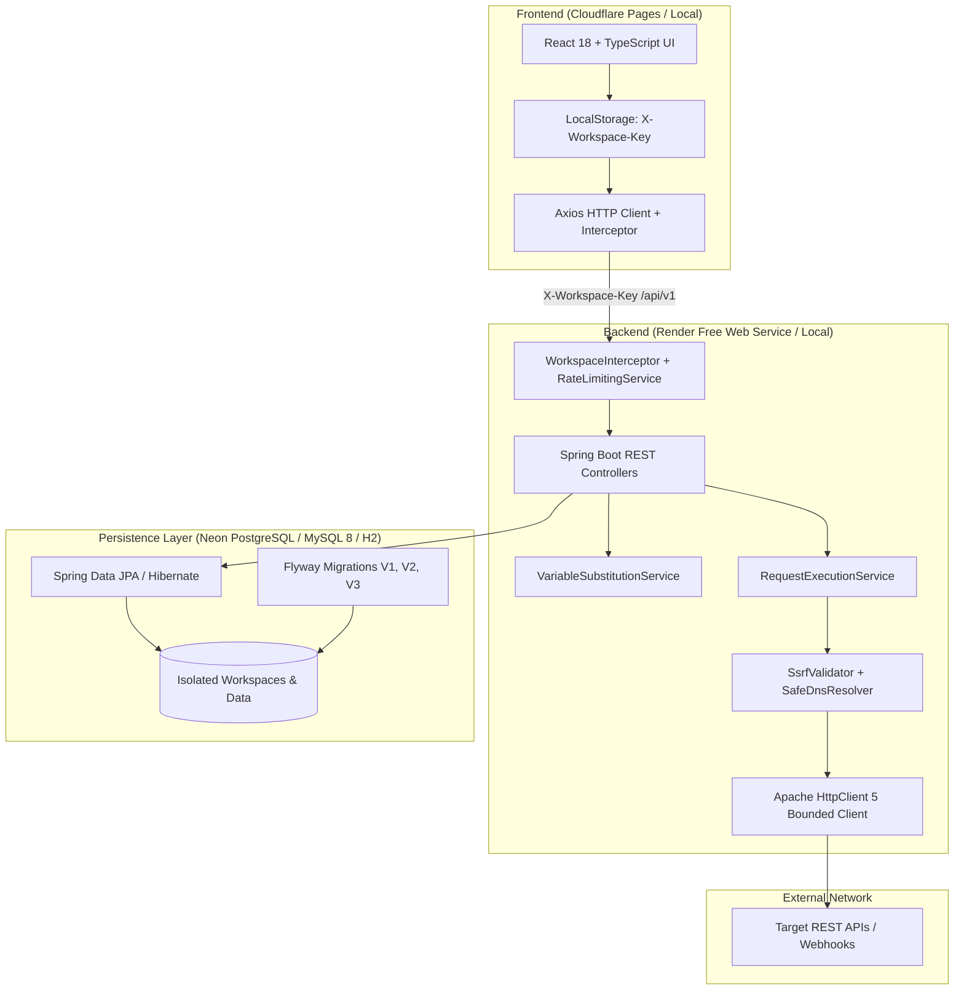

# API Testing Playground

A full-stack, secure, multi-tenant API testing platform built with React 18, TypeScript, Java 17, Spring Boot 3, and support for H2, MySQL 8, and PostgreSQL (Neon). It allows developers and testers to create, configure, execute, and inspect HTTP requests through a browser-based interface while enforcing strict resource protection, workspace isolation, rate limiting, and SSRF defenses.

---

## Architecture Overview



---

## Key Features

### 1. Interactive Request Builder
- Full HTTP method support: `GET`, `POST`, `PUT`, `PATCH`, `DELETE`, `HEAD`, `OPTIONS`.
- Configurable URL, query parameters, custom headers, authorization schemes, and body payloads (JSON, text).
- Real-time execution with status badges, response size, duration timing, and formatted response body viewer.
- Copy request as reproducible `cURL` command with one click.
- Client-side execution cancellation via standard `AbortController`.

### 2. Anonymous Workspace Isolation
- **High-Entropy Credentials:** Server-generated 256-bit cryptographic workspace keys (`wpk_...`).
- **Server-Side Key Hashing:** Stored securely using SHA-256 hashes (`workspaces` table); raw keys are never stored on the backend.
- **Strict Data Isolation:** Every query and mutation for Collections, Saved Requests, Environments, and History enforces workspace ownership.
- **Enumeration Defense:** Attempts to access or mutate another workspace's records return `404 Not Found`, preventing resource enumeration.
- **Zero Configuration for Visitors:** The frontend automatically acquires and persists the workspace key in browser `localStorage`.

### 3. Comprehensive Request Security & SSRF Defense
- **Strict Protocol Enforcement:** Only `http` and `https` schemes are accepted.
- **Anti-SSRF Protection:** Configurable blocking of private networks (RFC 1918), loopback (`127.0.0.0/8`, `::1`), link-local (`169.254.0.0/16`, `fe80::/10`), and cloud metadata services (`169.254.169.254`, `metadata.google.internal`).
- **Safe DNS Resolution:** Custom `SafeDnsResolver` wired into Apache HttpClient 5 socket connection pool to defend against DNS rebinding (TOCTOU) attacks.
- **Secure Redirects:** Automatic client redirects are disabled; redirects are validated hop-by-hop with loop detection and cross-origin credential stripping (RFC 7235).
- **Genuine 15-Second Outbound Deadline:** Enforced across all redirect hops, DNS resolution, connection acquisition, and response body streaming.
- **Bounded Stream Reading:** Enforces maximum response body limits (default 5 MB); oversized streams are aborted promptly and connection sockets are released without memory exhaustion.

### 4. Public API Abuse Prevention & Rate Limiting
- **In-Memory Token Bucket Rate Limiting:** Enforced server-side for expensive operations.
  - Workspace creation: 10 requests / minute per client IP.
  - Outbound request execution: 30 requests / minute per workspace.
- Returns HTTP `429 Too Many Requests` with a `Retry-After: 60` response header.

### 5. Sensitive Data & History Redaction
- **Secret Environment Variables:** Secret values are returned masked with `********` across all endpoints (`GET /api/v1/environments`). Blank or masked updates preserve stored secrets.
- **History Redaction:** Automatically redacts sensitive query parameters (`apiKey`, `token`, `password`, `secret`, `authorization`, etc.), sensitive headers (`Authorization`, `X-API-Key`, `Cookie`), and recursively redacts sensitive JSON fields before storing in database history.
- **Environment Secret Redaction:** Environment secret values substituted into URLs or request bodies are sanitized to `[REDACTED]` prior to persistence.

### 6. Sanitized Health Endpoint
- Anonymous health check (`GET /api/v1/health`) reports service health (`UP` / `DEGRADED`) and database connectivity status.
- Never discloses JDBC connection URLs, hostnames, database usernames, vendor details, or stack traces.

---

## Technology Stack

| Layer | Technologies |
|---|---|
| **Frontend** | React 18, TypeScript, Vite, Tailwind CSS, Axios, Lucide Icons |
| **Backend** | Java 17, Spring Boot 3.2.5, Spring Data JPA, Hibernate 6, Maven |
| **Outbound HTTP** | Apache HttpClient 5 (classic connection pooling, custom DNS resolver) |
| **Database Support** | H2 (in-memory test / embedded file dev), MySQL 8, PostgreSQL 15+ / Neon |
| **Database Migrations** | Flyway (V1 Schema, V2 Environments & Saved Requests, V3 Workspace Isolation) |
| **Testing** | JUnit 5, Mockito, Spring Boot Test, Vitest, React Testing Library |
| **Deployment Targets** | Cloudflare Pages (Frontend), Render Free Web Service (Backend), Neon (PostgreSQL) |
| **Containerization** | Docker, Docker Compose |

---

## Environment Variables Reference

### Backend Configuration

| Environment Variable | Default Value | Description |
|---|---|---|
| `PORT` | `8080` | HTTP port assigned by Render or container runtime |
| `SPRING_PROFILES_ACTIVE` | `default` | Active Spring profile (`default`, `mysql`, or `postgres`) |
| `SPRING_DATASOURCE_URL` | H2 file db | JDBC database URL (e.g., `jdbc:postgresql://<neon-host>/<db>?sslmode=require`) |
| `SPRING_DATASOURCE_USERNAME` | `sa` | Database connection username |
| `SPRING_DATASOURCE_PASSWORD` | *(empty)* | Database connection password |
| `SPRING_DATASOURCE_DRIVER` | `org.h2.Driver` | JDBC driver class name (`org.postgresql.Driver`, `com.mysql.cj.jdbc.Driver`) |
| `PLAYGROUND_CORS_ALLOWED_ORIGINS` | `http://localhost:[*],...` | Comma-separated list of allowed frontend origins (e.g., `https://<app>.pages.dev`) |
| `PLAYGROUND_ALLOW_LOOPBACK` | `true` (dev) / `false` (prod) | Allow requests to `localhost` / `127.0.0.1` (disable in public production) |
| `PLAYGROUND_ALLOW_PRIVATE_IPS` | `true` (dev) / `false` (prod) | Allow requests to RFC 1918 private IP ranges (disable in public production) |

### Frontend Configuration

| Environment Variable | Default Value | Description |
|---|---|---|
| `VITE_API_URL` | *(empty / relative)* | Backend API base URL (e.g., `https://<backend-service>.onrender.com`). Falls back to relative `/api/v1` for Vite proxy. |

---

## Local Development Setup

### Prerequisites
- **Java 17** (JDK 17)
- **Maven** (3.8+)
- **Node.js** (18+) and **npm** (9+)
- **Git**

### 1. Clone Repository
```bash
git clone https://github.com/mdsaifswe/api-testing-playground.git
cd api-testing-playground
```

### 2. Start Backend (Local H2 Mode)
```bash
cd backend
mvn spring-boot:run
```
The backend starts on `http://localhost:8080` with:
- Health endpoint: `http://localhost:8080/api/v1/health`
- Swagger UI documentation: `http://localhost:8080/swagger-ui.html`
- Embedded Echo server: `http://localhost:8080/api/v1/echo/...`

### 3. Start Frontend
In a new terminal window:
```bash
cd frontend
npm install
npm run dev
```
Open `http://localhost:5173` in your browser.

---

## Running Automated Tests

### Backend Test Suite (JUnit 5 + Spring Boot Test)
```bash
cd backend
mvn test
```
*Executes all 89 unit, security, and integration tests against an isolated in-memory H2 database.*

To build and package the production JAR:
```bash
mvn package -DskipTests
```

### Frontend Test Suite (Vitest + React Testing Library)
```bash
cd frontend
npm test -- --run
```
*Executes all 21 frontend unit and component tests.*

To build the production bundle:
```bash
npm run build
```

---

## Production Deployment Guide

### Deployment Architecture
- **Frontend:** Cloudflare Pages (free edge static hosting)
- **Backend:** Render Free Web Service (Docker / container-aware JVM)
- **Database:** Neon Free Serverless PostgreSQL

---

### Step 1: Set Up Neon Database (PostgreSQL)
1. Log in to [Neon Console](https://console.neon.tech).
2. Create a new project (e.g., `api-testing-playground-db`).
3. Neon provides a PostgreSQL connection string in the format:
   ```text
   postgresql://<username>:<password>@<ep-xyz>.us-east-2.aws.neon.tech/<dbname>?sslmode=require
   ```
4. Note the host, database name, username, and password.
5. Spring Boot format for JDBC URL:
   ```text
   jdbc:postgresql://<ep-xyz>.us-east-2.aws.neon.tech/<dbname>?sslmode=require
   ```
*Flyway migrations (`V1`, `V2`, `V3`) will automatically execute on application startup.*

---

### Step 2: Deploy Backend to Render
1. Log in to [Render Dashboard](https://dashboard.render.com).
2. Click **New +** -> **Web Service**.
3. Connect your GitHub repository `mdsaifswe/api-testing-playground`.
4. Configure service parameters:
   - **Name:** `api-testing-playground-backend`
   - **Root Directory:** *(leave blank or `backend`)*
   - **Runtime:** `Docker` (Render automatically uses `backend/Dockerfile`)
   - **Instance Type:** `Free`
5. Configure Environment Variables in Render:
   - `SPRING_PROFILES_ACTIVE`: `postgres`
   - `SPRING_DATASOURCE_URL`: `jdbc:postgresql://<neon-host>/<dbname>?sslmode=require`
   - `SPRING_DATASOURCE_USERNAME`: `<neon-username>`
   - `SPRING_DATASOURCE_PASSWORD`: `<neon-password>`
   - `PLAYGROUND_CORS_ALLOWED_ORIGINS`: `https://<your-project>.pages.dev` *(update after Step 3)*
   - `PLAYGROUND_ALLOW_LOOPBACK`: `false`
   - `PLAYGROUND_ALLOW_PRIVATE_IPS`: `false`
6. Deploy the web service. Render will assign an HTTPS URL:
   `https://api-testing-playground-backend.onrender.com`
7. Verify deployment:
   ```bash
   curl https://api-testing-playground-backend.onrender.com/api/v1/health
   ```

---

### Step 3: Deploy Frontend to Cloudflare Pages
1. Log in to [Cloudflare Dashboard](https://dash.cloudflare.com) and navigate to **Workers & Pages**.
2. Click **Create application** -> **Pages** -> **Connect to Git**.
3. Select `mdsaifswe/api-testing-playground`.
4. Configure Build settings:
   - **Framework preset:** `Vite`
   - **Build command:** `npm run build`
   - **Build output directory:** `dist`
   - **Root directory:** `frontend`
5. Configure Environment Variable:
   - `VITE_API_URL`: `https://api-testing-playground-backend.onrender.com`
6. Click **Save and Deploy**.
7. Cloudflare Pages assigns a domain: `https://<your-project>.pages.dev`.
8. **Final Step:** Copy your Cloudflare Pages domain and paste it into Render's `PLAYGROUND_CORS_ALLOWED_ORIGINS` environment variable.

---

## Known Security Limitations & Operational Boundaries

1. **Anonymous Workspace Persistence:** Workspace credentials (`wpk_...`) are stored in browser `localStorage`. Clearing browser data or opening the site in a private/incognito window creates a new workspace. Anonymous workspaces intentionally do not provide account recovery or cross-device synchronization.
2. **In-Memory Rate Limiting:** Rate limiting uses a single-instance token bucket suitable for single-node deployments (e.g., Render Free). In a horizontally scaled cluster, rate limits are enforced per instance unless backed by a distributed cache like Redis.
3. **Outbound Network Scope:** Public deployment is intended for testing public HTTP/HTTPS APIs. Outbound connections to private corporate intranets, localhost, and cloud metadata services are intentionally blocked by design.

---

## Author

**Md. Saif**
- GitHub: [@mdsaifswe](https://github.com/mdsaifswe)
- Repository: [api-testing-playground](https://github.com/mdsaifswe/api-testing-playground)
