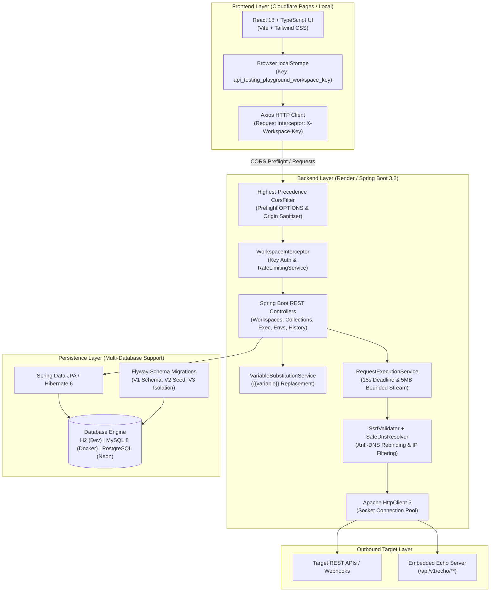

# API Testing Playground

[](https://api-testing-playground-a36.pages.dev)
[](https://api-testing-playground.onrender.com/api/v1/health)
[](https://api-testing-playground.onrender.com/swagger-ui.html)
[](https://github.com/mdsaifswe/api-testing-playground/actions)

A secure, full-stack, browser-based API testing platform built with **React 18**, **TypeScript**, **Java 17**, and **Spring Boot 3.2**. Designed as a lightweight, zero-install alternative to desktop HTTP clients like Postman and Insomnia, API Testing Playground allows developers to construct, execute, and analyze HTTP requests while enforcing defense-in-depth security, strict workspace isolation, token bucket rate limiting, and server-side SSRF mitigation.

---

## 🔗 Live Deployments & Verified Links

| Resource | URL | Description |
|---|---|---|
| **Live Frontend Application** | [https://api-testing-playground-a36.pages.dev](https://api-testing-playground-a36.pages.dev) | Production single-page application hosted on Cloudflare Pages |
| **Backend Health Check** | [https://api-testing-playground.onrender.com/api/v1/health](https://api-testing-playground.onrender.com/api/v1/health) | Sanitized service status, uptime, and database connectivity check |
| **Swagger / OpenAPI Documentation** | [https://api-testing-playground.onrender.com/swagger-ui.html](https://api-testing-playground.onrender.com/swagger-ui.html) | Interactive OpenAPI 3.0 specification & endpoint testing explorer |
| **GitHub Repository** | [https://github.com/mdsaifswe/api-testing-playground](https://github.com/mdsaifswe/api-testing-playground) | Complete open-source project repository & CI/CD workflows |

---

## 📸 Application Screenshots

> *Note: Application screenshots can be viewed directly by accessing the [Live Application](https://api-testing-playground-a36.pages.dev). To maintain complete repository cleanliness, binary image files are omitted from the git tree.*

---

## 🌟 Key Engineering Features

### 1. Interactive HTTP Request Builder
- **Full Method Support:** `GET`, `POST`, `PUT`, `PATCH`, `DELETE`, `HEAD`, and `OPTIONS`.
- **Configurable Parameters:** Custom query parameters, HTTP headers, authentication schemes (Bearer Token, Basic Auth, API Key), and payload formats (JSON, Raw Text).
- **Execution Telemetry:** Live HTTP status code badges, exact round-trip response duration (`ms`), response body size (`KB` / `MB`), and syntax-highlighted JSON viewer.
- **cURL Command Generator:** One-click generation of fully reproducible cURL commands mirroring current headers, query parameters, and request body.
- **Client-Side Cancellation:** Integrated `AbortController` enabling instant client-side cancellation of pending outbound requests.

### 2. Multi-Tenant Workspace Isolation
- **Anonymous Cryptographic Credentials:** Automatically generates a 256-bit cryptographically secure token prefixed with `wpk_` (68 characters total) on first visit.
- **Server-Side SHA-256 Hashing:** Raw keys are never stored on the server. The backend computes and stores only SHA-256 digests in the `workspaces` table.
- **Strict Data Segregation:** All queries, mutations, collections, saved requests, environment variables, and history entries are strictly isolated by `workspace_id`.
- **Anti-Enumeration Defense:** Attempts to access or mutate resources belonging to another workspace return `404 Not Found`, preventing IDOR and tenant enumeration.
- **Zero Friction:** Handled seamlessly in the browser via `localStorage`, requiring no registration or email verification.

### 3. Outbound SSRF & Network Security Engine
- **Protocol Enforcement:** Strictly restricts outbound requests to `http` and `https` schemes.
- **Comprehensive IP Blocking:** Blocks outbound calls to loopback (`127.0.0.0/8`, `::1`), RFC 1918 private subnets (`10.0.0.0/8`, `172.16.0.0/12`, `192.168.0.0/16`), link-local (`169.254.0.0/16`, `fe80::/10`), and cloud provider metadata services (`169.254.169.254`, `metadata.google.internal`).
- **Safe DNS Resolution (`SafeDnsResolver`):** Custom DNS resolver wired directly into Apache HttpClient 5's socket connection pool to eliminate DNS Rebinding (TOCTOU) exploits.
- **Secure Redirect Validation:** Automatic client-side redirects are disabled. Outbound redirects are inspected hop-by-hop with loop detection, max-redirect caps (5 hops), and cross-origin Authorization header stripping (RFC 7235).
- **15-Second Hard Execution Deadline:** Strict end-to-end deadline spanning DNS lookup, socket connection, TLS handshake, and body streaming.
- **Bounded Stream Consumption:** Response bodies are read through a bounded stream (5 MB default limit). Oversized payloads are aborted immediately to protect server heap.

### 4. Abuse Prevention & Token Bucket Rate Limiting
- **Server-Side Token Bucket:** In-memory rate limiting applied before resource-intensive handlers execute.
  - **Workspace Creation:** 10 requests / minute per client IP.
  - **Request Execution:** 30 requests / minute per workspace.
  - **General API Operations:** 100 requests / minute per workspace.
- **Standardized Response:** Returns HTTP `429 Too Many Requests` accompanied by a `Retry-After: 60` header.

### 5. Sensitive Data Masking & History Redaction
- **Masked Environment Variables:** Environment variables marked as secrets are masked (`********`) across all API responses. Blank or masked submissions preserve existing values.
- **History Redaction:** Automatically scrubs sensitive query parameters (`apiKey`, `token`, `password`, `secret`), headers (`Authorization`, `X-API-Key`, `Cookie`), and nested JSON fields before persisting to execution history.
- **Sanitized Health Check:** Anonymous health endpoint reports service health and database availability without revealing hostnames, ports, JDBC URLs, or database engine versions.

### 6. Multi-Database Architecture (H2, MySQL 8, PostgreSQL)
- **H2 Database:** Zero-config file-based embedded database for local development and in-memory execution for automated tests.
- **MySQL 8:** First-class production-ready database supported via `application-mysql.yml` and containerized via `docker-compose.yml`.
- **PostgreSQL 15+ / Neon:** Production serverless database supported via `application-postgres.yml` with SSL-enforced connection pooling.
- **Flyway Versioned Migrations:** Dedicated migration paths (`classpath:db/migration` for H2/MySQL and `classpath:db/migration-postgres` for PostgreSQL) ensuring schema consistency across all databases.

---

## 🏗️ Architecture Overview



---

## 💻 Technology Stack

| Layer | Technology | Version | Purpose |
|---|---|---|---|
| **Frontend Framework** | React | 18.3.1 | Component-based reactive user interface |
| **Language (Frontend)** | TypeScript | 5.4.5 | Static typing, interfaces, and compile-time correctness |
| **Build Tool** | Vite | 5.2.11 | Ultra-fast HMR and optimized production bundling |
| **Styling** | Tailwind CSS | 3.4.3 | Modern utility-first responsive styling |
| **HTTP Client (Client)** | Axios | 1.7.2 | Interceptor-driven HTTP client with workspace key injection |
| **Icons** | Lucide React | 0.379.0 | Minimalist vector iconography |
| **Frontend Testing** | Vitest + RTL | 1.6.0 | Unit and component integration testing |
| **Backend Framework** | Spring Boot | 3.2.5 | Enterprise REST API framework |
| **Language (Backend)** | Java (OpenJDK) | 17 (LTS) | Modern Java language runtime |
| **ORM / Persistence** | Spring Data JPA / Hibernate | 6.4.4 | Type-safe repository abstraction and database mapping |
| **Outbound HTTP Engine** | Apache HttpClient 5 | 5.3.1 | Connection pooling, custom DNS resolver, bounded streaming |
| **Database Migrations** | Flyway | 10.10.0 | Automated, version-controlled database schema migrations |
| **Supported Databases** | H2, MySQL 8, PostgreSQL | - | Multi-database persistence across local, Docker, and Neon |
| **API Documentation** | Springdoc OpenAPI | 2.5.0 | Automated OpenAPI 3.0 specification & Swagger UI |
| **Backend Testing** | JUnit 5 + Mockito + MockMvc | - | Unit, security, and integration test suite |
| **Containerization** | Docker & Docker Compose | - | Reproducible local and production container builds |
| **Cloud Hosting** | Cloudflare Pages & Render | - | Global static edge distribution & containerized web service |

---

## 📁 Project Folder Structure

```text
api-testing-playground/
├── .github/
│   └── workflows/
│       └── ci.yml                     # GitHub Actions CI workflow (Backend & Frontend test/build)
├── backend/
│   ├── src/
│   │   ├── main/
│   │   │   ├── java/com/playground/api/
│   │   │   │   ├── config/            # CorsConfig, WebMvcConfig, PlaygroundSecurityProperties
│   │   │   │   ├── controller/        # REST Controllers (Workspace, Exec, Collections, etc.)
│   │   │   │   ├── dto/               # Request, Response, and Common DTOs
│   │   │   │   ├── entity/            # JPA Entities (Workspace, Collection, History, etc.)
│   │   │   │   ├── exception/         # Custom exceptions and GlobalExceptionHandler
│   │   │   │   ├── repository/        # Spring Data JPA Repositories
│   │   │   │   ├── security/          # SsrfValidator, SafeDnsResolver, WorkspaceInterceptor, RateLimiting
│   │   │   │   └── service/           # Business logic & execution services
│   │   │   └── resources/
│   │   │       ├── db/
│   │   │       │   ├── migration/     # Flyway SQL migrations for H2 & MySQL 8 (V1, V2, V3)
│   │   │       │   └── migration-postgres/ # Flyway SQL migrations for PostgreSQL / Neon
│   │   │       ├── application.yml    # Default configuration (H2 local file database)
│   │   │       ├── application-mysql.yml # MySQL 8 configuration profile
│   │   │       └── application-postgres.yml # PostgreSQL / Neon production configuration profile
│   │   └── test/                      # Comprehensive backend test suite (98 tests across 13 classes)
│   ├── Dockerfile                     # Multi-stage container build with container-aware JVM flags
│   └── pom.xml                        # Maven dependencies and build plugins
├── frontend/
│   ├── src/
│   │   ├── components/                # UI components (request, response, collections, environments)
│   │   ├── services/                  # Axios API client, interceptors, and workspace storage
│   │   ├── test/                      # Vitest unit and component tests (21 tests across 5 files)
│   │   ├── types/                     # TypeScript domain models and interfaces
│   │   └── utils/                     # cURL generator, formatting helpers, variable substitution
│   ├── Dockerfile                     # Multi-stage Nginx container build
│   ├── nginx.conf                     # Nginx static distribution & reverse proxy configuration
│   ├── package.json                   # Frontend dependencies and npm scripts
│   └── vite.config.ts                 # Vite bundler configuration & local dev proxy
├── docker-compose.yml                 # Multi-container orchestration (MySQL 8 + Backend + Frontend)
├── .env.example                       # Documented environment variable template
└── README.md                          # Comprehensive project documentation
```

---

## ⚙️ Prerequisites

Before running the project locally, ensure you have the following installed:

- **Java Development Kit (JDK):** Version 17 or higher
- **Apache Maven:** Version 3.8+ (or use the built-in IDE Maven runner)
- **Node.js:** Version 18.x or 20.x LTS
- **npm:** Version 9.x or higher
- **Git:** Version 2.x
- **Docker & Docker Compose** *(Optional, for containerized MySQL execution)*

---

## 🚀 Local Installation & Setup

### 1. Clone the Repository
```bash
git clone https://github.com/mdsaifswe/api-testing-playground.git
cd api-testing-playground
```

### 2. Run the Backend

#### Option A: Default In-Memory / File Database (H2 — Fastest Setup)
The backend defaults to an embedded H2 database (`api_playground_db`), requiring zero database installation:
```bash
cd backend
mvn spring-boot:run
```
The backend initializes on `http://localhost:8080`.

#### Option B: Using MySQL 8
To run with a local or containerized MySQL 8 instance:
1. Ensure MySQL is running on port `3306` with database `api_testing_playground`.
2. Start the backend with the `mysql` Spring profile:
```bash
cd backend
mvn spring-boot:run -Dspring-boot.run.profiles=mysql
```

#### Option C: Using PostgreSQL
To run against PostgreSQL (such as Neon):
```bash
cd backend
mvn spring-boot:run -Dspring-boot.run.profiles=postgres
```

### 3. Run the Frontend
In a new terminal window:
```bash
cd frontend
npm install
npm run dev
```
The frontend starts on `http://localhost:5173` with automated Vite reverse proxying to `http://localhost:8080`.

### 4. Verify Local URLs
- **Web Application:** [http://localhost:5173](http://localhost:5173)
- **Backend Health Check:** [http://localhost:8080/api/v1/health](http://localhost:8080/api/v1/health)
- **Swagger Documentation:** [http://localhost:8080/swagger-ui.html](http://localhost:8080/swagger-ui.html)
- **Embedded Echo Server:** [http://localhost:8080/api/v1/echo/get](http://localhost:8080/api/v1/echo/get)

---

## 🔐 Environment Variables

### Backend Configuration

| Variable | Profile | Default Value | Description |
|---|---|---|---|
| `PORT` | All | `8080` | Web server listening port (dynamically injected by Render) |
| `SPRING_PROFILES_ACTIVE` | All | `default` | Active profile: `default` (H2), `mysql` (MySQL 8), or `postgres` (Neon) |
| `SPRING_DATASOURCE_URL` | All | `jdbc:h2:file:./data/...` | Full JDBC database connection string |
| `SPRING_DATASOURCE_USERNAME` | All | `sa` | Database user account |
| `SPRING_DATASOURCE_PASSWORD` | All | *(empty)* | Database user password |
| `DB_HOST` | MySQL | `localhost` | Database host (used in `application-mysql.yml`) |
| `DB_PORT` | MySQL | `3306` | Database port (used in `application-mysql.yml`) |
| `DB_NAME` | MySQL | `api_testing_playground`| Database schema name |
| `DB_USER` | MySQL | `root` | Database username |
| `DB_PASSWORD` | MySQL | `root` | Database password |
| `PLAYGROUND_CORS_ALLOWED_ORIGINS` | All | `http://localhost:[*],...` | Comma-separated list of allowed frontend origins |
| `PLAYGROUND_ALLOW_LOOPBACK` | Dev/Prod | `true` (dev) / `false` (prod) | Allows outbound requests to `localhost` / `127.0.0.1` |
| `PLAYGROUND_ALLOW_PRIVATE_IPS` | Dev/Prod | `true` (dev) / `false` (prod) | Allows outbound requests to RFC 1918 private subnets |

### Frontend Configuration

| Variable | Default Value | Example Production Value | Description |
|---|---|---|---|
| `VITE_API_URL` | *(empty / relative)* | `https://api-testing-playground.onrender.com` | Base backend URL. Falls back to relative `/api/v1` in local development to use the Vite proxy. |

---

## 📖 API Documentation & Core Endpoints

The backend exposes an interactive OpenAPI 3.0 / Swagger UI at `/swagger-ui.html`.

### Key REST Endpoints

| Category | HTTP Method | Endpoint | Description | Auth Required |
|---|---|---|---|:---:|
| **Workspaces** | `POST` | `/api/v1/workspaces` | Generate a new isolated workspace & secure key | No |
| **Execution** | `POST` | `/api/v1/execute` | Execute an outbound HTTP request with SSRF & timeout checks | Yes |
| **Collections** | `GET` | `/api/v1/collections` | List all collections belonging to current workspace | Yes |
| | `POST` | `/api/v1/collections` | Create a new collection in current workspace | Yes |
| | `GET` / `PUT` / `DELETE`| `/api/v1/collections/{id}` | Retrieve, update, or remove a collection | Yes |
| **Saved Requests** | `GET` / `POST` | `/api/v1/saved-requests` | List or save requests to a workspace collection | Yes |
| | `GET` / `PUT` / `DELETE`| `/api/v1/saved-requests/{id}`| Retrieve, update, or delete a saved request | Yes |
| **Environments** | `GET` / `POST` | `/api/v1/environments` | List or create variable environments (secrets masked) | Yes |
| | `PATCH` | `/api/v1/environments/{id}/activate` | Set active environment for variable substitution | Yes |
| **History** | `GET` | `/api/v1/history` | List sanitized request history for current workspace | Yes |
| | `DELETE` | `/api/v1/history` | Clear all execution history for current workspace | Yes |
| **Service Health** | `GET` | `/api/v1/health` | Sanitized service status, database connectivity & memory | No |
| **Echo Server** | `GET` / `POST` / `PUT` | `/api/v1/echo/**` | Local mock testing utilities (echo payloads, auth, delays) | No |

*Note: All endpoints marked `Yes` for Auth require the `X-Workspace-Key` header.*

---

## 🧪 Running Automated Tests

The repository maintains full-stack automated test coverage across unit, security, and integration layers.

### Backend Test Suite (JUnit 5 + Spring Boot Test)
Executes **98 automated tests** covering workspace isolation, token bucket rate limits, SSRF validation, DNS rebinding prevention, secret masking, bounded streaming, and CORS preflight handling:
```bash
cd backend
mvn test
```

To package the production executable JAR without running tests:
```bash
cd backend
mvn package -DskipTests
```

### Frontend Test Suite (Vitest + React Testing Library)
Executes **21 automated tests** covering API client interceptors, variable substitution, authentication configuration, method selection, and response parsing:
```bash
cd frontend
npm test
```

To create the optimized production frontend bundle:
```bash
cd frontend
npm run build
```

---

## 🐳 Docker & Docker Compose Setup

Run the entire multi-tier stack locally in containerized isolation (MySQL 8 + Spring Boot Backend + Nginx Frontend):

```bash
docker compose up --build
```

### Container Architecture
1. **`mysql`:** MySQL 8.0 server with automated healthcheck (`localhost:3306`).
2. **`backend`:** Container-aware Spring Boot service connected to MySQL with a 70% MaxRAMPercentage policy (`localhost:8080`).
3. **`frontend`:** Multi-stage Nginx alpine container distributing the production React bundle (`localhost:3000`).

To stop all containers:
```bash
docker compose down
```

---

## 🌐 Production Deployment Architecture

The application is deployed across high-availability free-tier cloud platforms:
- **Frontend:** Cloudflare Pages (Edge CDN static distribution)
- **Backend:** Render Free Web Service (Dockerized Spring Boot application)
- **Database:** Neon Free Serverless PostgreSQL (Managed cloud database with SSL enforcement)

```
[Browser Client]
       │
       ▼ (HTTPS)
[Cloudflare Pages CDN] ──► https://api-testing-playground-a36.pages.dev
       │
       ▼ (REST API Calls + X-Workspace-Key)
[Render Free Web Service] ──► https://api-testing-playground.onrender.com
       │
       ▼ (Encrypted PostgreSQL Connection)
[Neon Serverless Database]
```

### Step 1: Neon PostgreSQL Database Setup
1. Create a project in the [Neon Console](https://console.neon.tech).
2. Retrieve your PostgreSQL connection string:
   ```text
   postgresql://<username>:<password>@<neon-host>.us-east-2.aws.neon.tech/<dbname>?sslmode=require
   ```
3. Format the JDBC connection string:
   ```text
   jdbc:postgresql://<neon-host>.us-east-2.aws.neon.tech/<dbname>?sslmode=require
   ```

### Step 2: Render Backend Web Service Setup
1. In the [Render Dashboard](https://dashboard.render.com), create a **New Web Service** connected to your repository (`mdsaifswe/api-testing-playground`).
2. Configure settings:
   - **Name:** `api-testing-playground`
   - **Branch:** `main`
   - **Root Directory:** `backend` *(do not leave blank)*
   - **Runtime:** `Docker`
   - **Dockerfile Path:** `Dockerfile`
   - **Instance Type:** `Free`
3. Configure Environment Variables in Render:
   - `SPRING_PROFILES_ACTIVE`: `postgres`
   - `SPRING_DATASOURCE_URL`: `jdbc:postgresql://<neon-host>/<dbname>?sslmode=require`
   - `SPRING_DATASOURCE_USERNAME`: `<neon-username>`
   - `SPRING_DATASOURCE_PASSWORD`: `<neon-password>`
   - `PLAYGROUND_CORS_ALLOWED_ORIGINS`: `https://api-testing-playground-a36.pages.dev`
   - `PLAYGROUND_ALLOW_LOOPBACK`: `false`
   - `PLAYGROUND_ALLOW_PRIVATE_IPS`: `false`
4. Deploy the service. Your backend will be accessible at:
   `https://api-testing-playground.onrender.com`

### Step 3: Cloudflare Pages Frontend Setup
1. In the [Cloudflare Dashboard](https://dash.cloudflare.com), navigate to **Workers & Pages** -> **Create application** -> **Pages** -> **Connect to Git**.
2. Select `mdsaifswe/api-testing-playground` and configure:
   - **Production branch:** `main`
   - **Root directory:** `frontend`
   - **Framework preset:** `Vite`
   - **Build command:** `npm run build`
   - **Build output directory:** `dist`
3. Set the Environment Variable:
   - `VITE_API_URL`: `https://api-testing-playground.onrender.com`
4. Click **Save and Deploy**. Cloudflare Pages deploys to:
   `https://api-testing-playground-a36.pages.dev`

---

## 🛡️ Security Architecture & Defense-in-Depth

| Security Vector | Implementation Detail | Risk Addressed |
|---|---|---|
| **Server-Side Request Forgery (SSRF)** | `SsrfValidator` blocks RFC 1918 subnets, link-local, loopback, and cloud metadata endpoints. | Internal network probing & credential extraction |
| **DNS Rebinding (TOCTOU)** | `SafeDnsResolver` resolves addresses during Apache HttpClient 5 socket creation. | Bypassing pre-flight IP filters via malicious DNS TTL |
| **Tenant Isolation** | SHA-256 hashed workspace tokens; all queries filtered by `workspace_id`. | Cross-tenant data leakage & unauthorized modification |
| **Enumeration / IDOR** | Unowned entity queries return `404 Not Found` rather than `403 Forbidden`. | Resource existence probing and collection harvesting |
| **Denial of Service (DoS)** | 15s execution deadline & bounded 5 MB response stream reading. | Server thread exhaustion & out-of-memory crashes |
| **API Abuse** | Token bucket rate limiting (10/min workspace create; 30/min execute). | Automated spam & outbound proxy abuse |
| **Information Disclosure** | Environment secret masking (`********`) & history parameter/header sanitization. | Leaking API keys, tokens, or credentials in responses |
| **CORS Preflight Integrity** | Highest-precedence `CorsFilter` bean supporting credentials & header validation. | Browser preflight blocking on Render and Cloudflare Pages |

---

## ⚠️ Known Limitations & Boundaries

1. **Anonymous LocalStorage Scoping:** Workspaces are tied to the browser's `localStorage`. Opening an Incognito window or clearing browser data creates a fresh workspace. Anonymous workspaces do not support account recovery or multi-device synchronization.
2. **In-Memory Rate Limiting:** The token bucket rate limiter runs in the backend JVM memory. In a horizontally autoscaled cluster, rate limits apply per node rather than globally (a distributed cache like Redis would be required for global cluster enforcement).
3. **Restricted Outbound Network Scope:** The public deployment intentionally prohibits requests to `localhost`, RFC 1918 internal networks, and cloud metadata addresses to protect the hosting infrastructure.

---

## 🔮 Future Improvements

- **User Accounts & Multi-Device Sync:** Optional OAuth2 / JWT login to synchronize workspaces across multiple devices.
- **WebSocket & GraphQL Support:** Interactive testing of WebSocket connections and GraphQL schemas.
- **Automated Test Assertions:** Post-execution assertion scripts (e.g., status checks, JSON schema validation, response time benchmarks).
- **Distributed Cache Integration:** Redis-backed rate limiting and session synchronization for multi-instance deployments.

---

## 👨‍💻 Author

**Md. Saif**
- **GitHub:** [@mdsaifswe](https://github.com/mdsaifswe)
- **Repository:** [api-testing-playground](https://github.com/mdsaifswe/api-testing-playground)
